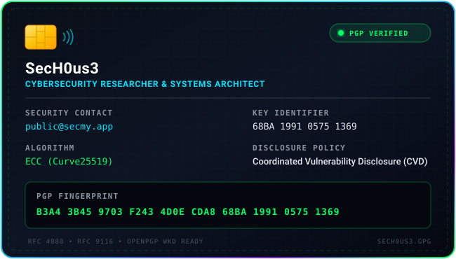

<div align="center">

<!-- Hacker-style typewriter header -->
<a href="https://github.com/SecH0us3">
  
</a>

<p align="center">
  <b>Security Research • Web Application Firewalls • API Security • Threat Intelligence</b>
</p>

<!-- Badges & Memberships Bar -->
<p align="center">
  <a href="https://www.acm.org/">
    
  </a>
  <a href="https://www.credly.com/org/isc2/badge/certified-in-cybersecurity-cc">
    
  </a>
  <a href="https://www.451alliance.com/">
    
  </a>
  <a href="https://www.credly.com/users/alexpa/badges/credly">
    
  </a>
  <a href="https://developer.chrome.com/">
    
  </a>
</p>

</div>

---

## ⚡ Overview & Affiliations

<table>
<tr>
<td width="55%" valign="top">

### 🛡️ Focus & Work
- 🎯 **Main Areas:** Web Application Firewalls (WAF), API fuzzing, session security (DBSC), and threat analysis
- 🔬 **Research:** WAF bypass testing, network defense, and CI/CD security hardening for developer tools
- ✍️ **Writing:** Author of **[Your Sec](https://yoursec.substack.com/)**, sharing practical guides on security, architecture, and code quality
- 🌐 **Open Source:** Contributor to **[chrome.dev](https://developer.chrome.com/)** documentation and web platform demos

</td>
<td width="45%" valign="top">

### 🏛️ Memberships & Certifications
- 🏅 **[ACM](https://www.acm.org/)** - Association for Computing Machinery Member
- 📊 **[451 Alliance](https://www.451alliance.com/)** - Research Member
- 🛡️ **[ISC2](https://www.credly.com/org/isc2/badge/certified-in-cybersecurity-cc)** - Certified in Cybersecurity (CC)
- 🎓 **[IBM Cybersecurity Analyst](https://www.credly.com/org/coursera/badge/ibm-cybersecurity-analyst-professional-certificate)** - Professional Certificate & Assessment
- 🌐 **[Credly Profile](https://www.credly.com/users/alexpa/badges/credly)** - All Verified Badges & Skills

</td>
</tr>
</table>

---

## 🎯 Top 10 Core Skills

```
 1. Web Security & Penetration Testing      [████████████████████]  WAF Evasion, SSRF, XSS, SQLi
 2. Web Application Firewall (WAF) Defense  [████████████████████]  Cloudflare Workers, Custom Rules
 3. API Security & Automated Fuzzing        [███████████████████░]  OpenAPI / Swagger, gRPC, Postman
 4. Incident Response & Forensics           [██████████████████░░]  DFIR, Log Analysis, Threat Hunting
 5. Threat Intelligence & SIEM              [█████████████████░░░]  Threat Feeds, Attack Surface Analysis
 6. Session Security & DBSC Protocols       [█████████████████░░░]  Device Bound Session Credentials
 7. Network Defense & Traffic Analysis      [████████████████░░░░]  Packet Inspection, TLS, Reverse Proxies
 8. Secure CI/CD & AI Agent Guardrails      [████████████████░░░░]  Pipeline Security, Prompt Defenses
 9. Security Standards & Compliance         [███████████████░░░░░]  NIST, GDPR, HIPAA, Best Practices
10. Software Development                    [███████████████░░░░░]  C#, F#, Go, Python, TypeScript
```

---

## 🛠️ Languages & Technologies

| Category / Vendor | Technologies & Ecosystem |
| :--- | :--- |
| **Languages & Runtimes** |        |
| **Databases & Caching** |      |
| **Messaging & Queues** |   |
| **Cloudflare Ecosystem** |        |
| **Cloud & Containers** |    |
| **Protocols & Architectures** |     |

---

## 🚀 Featured GitHub Projects

<table>
<tr>
<td width="50%" valign="top">

### 🛡️ [waf-checker](https://github.com/SecH0us3/waf-checker)
*Testing tool to evaluate Web Application Firewall rules against web attacks*
- Works as a **Cloudflare Worker** (with Web UI) or standalone **Node.js CLI**
- Automated tests for common injection and bypass techniques
- **360+ tests passing**, **93%+ test coverage**, safe request handling
- 🌐 **Live Demo:** [waf.secmy.app](https://waf.secmy.app/)

```bash
npx @waf-checker/cli \
  --target https://example.com \
  --category xss,sqli
```

</td>
<td width="50%" valign="top">

### ⚡ [swazz](https://github.com/SecH0us3/swazz)
*Smart API fuzzer to find security issues and input bugs*
- Supports **OpenAPI (v2/v3)**, **Postman Collections**, **SOAP**, and **gRPC**
- Smart payload generation to discover crashes, data leaks, and weak validation
- Web dashboard and SARIF reports ready for CI/CD pipelines
- 🌐 **Live Demo:** [swazz.secmy.app](https://swazz.secmy.app/)

```bash
# Schema-aware fuzzing and vulnerability scans
```

</td>
</tr>
<tr>
<td width="50%" valign="top">

### 🍯 [honeypot](https://github.com/SecH0us3/honeypot)
*Cloudflare Worker honeypot designed to trap scanners and malicious crawlers*
- Serves dynamic fake `.git` configs, `.env` secrets, fake admin panels, and database dumps
- Deceives automated reconnaissance tools and collects threat telemetry
- 🌐 **Live Demo:** [hp.secmy.app](https://hp.secmy.app/)

</td>
<td width="50%" valign="top">

### 🤖 [harden-ci](https://github.com/SecH0us3/harden-ci)
*Security guidelines and guardrails for CI/CD pipelines and AI coding agents*
- Helps prevent leaked secrets, unsafe branch changes, and risky script execution in automated setups
- Hardened pipeline recipes and defense blueprints for developers
- 🌐 **Live Site:** [harden-ci.secmy.app](https://harden-ci.secmy.app/)

</td>
</tr>
</table>

<p align="center">
  <a href="https://github.com/SecH0us3?tab=repositories">
    
  </a>
  &nbsp;&nbsp;
  <a href="https://yoursec.substack.com/">
    
  </a>
</p>

---

## 📚 Recommended Books for Developers

Selected books from my reading list:  
👉 **[Must-Read Books for Developers (Full List)](https://yoursec.substack.com/p/must-read-books-for-developers?utm_source=publication-search)**

<table>
<tr>
<td width="50%" valign="top">

- 🏛️ **[Designing Data-Intensive Applications](https://yoursec.substack.com/p/must-read-books-for-developers)** - *Martin Kleppmann*  
  *Data systems, distributed architectures, and scalability*
- 🏢 **[Microsoft .NET - Architecting Applications for the Enterprise](https://yoursec.substack.com/p/must-read-books-for-developers)** - *Dino Esposito*  
  *Enterprise patterns, layered design, and maintainable .NET architecture*
- ⚙️ **[Structured Computer Organization](https://yoursec.substack.com/p/must-read-books-for-developers)** - *Andrew S. Tanenbaum*  
  *Computer architecture, hardware abstractions, and system fundamentals*
- 💻 **[Code Complete](https://yoursec.substack.com/p/must-read-books-for-developers)** - *Steve McConnell*  
  *Comprehensive guide to writing solid, reliable code*
- 🛠️ **[The Pragmatic Programmer](https://yoursec.substack.com/p/must-read-books-for-developers)** - *Andrew Hunt & David Thomas*  
  *Practical tips and habits to become a better software engineer*

</td>
<td width="50%" valign="top">

- 🎯 **[Real-World Bug Hunting: A Field Guide to Web Hacking](https://yoursec.substack.com/p/must-read-books-for-developers)** - *Peter Yaworski*  
  *Clear introduction to web application hacking and bug bounties*
- 🧮 **[The Algorithm Design Manual](https://yoursec.substack.com/p/must-read-books-for-developers)** - *Steven S. Skiena*  
  *Practical algorithm design, graph problem solving, and data structures guide*
- 💡 **[Joel on Software](https://yoursec.substack.com/p/must-read-books-for-developers)** - *Joel Spolsky*  
  *Timeless insights on software team culture, management, and UI design*
- 🔄 **[Refactoring & Clean Code](https://yoursec.substack.com/p/must-read-books-for-developers)** - *Martin Fowler & Robert C. Martin*  
  *Techniques for cleaning up legacy code and keeping systems readable*
- 🔐 **[Cryptonomicon](https://yoursec.substack.com/p/must-read-books-for-developers)** - *Neal Stephenson*  
  *Classic tech novel about cryptography, computing history, and hackers*

</td>
</tr>
</table>

---

## 🔐 Security Disclosure & Contact

I support coordinated vulnerability disclosure and encrypted communication

<div align="center">

<a href="https://github.com/SecH0us3.gpg">
  
</a>

<br/><br/>

<p align="center">
  <a href="pgp.asc">
    
  </a>
  <a href="https://github.com/SecH0us3.gpg">
    
  </a>
  <a href="https://keys.openpgp.org/search?q=public@secmy.app">
    
  </a>
  <a href="mailto:public@secmy.app">
    
  </a>
</p>

</div>

<details>
<summary>📋 <b>Click to view copyable details &amp; terminal commands</b></summary>
<br/>

```text
Contact:       public@secmy.app
Algorithm:     ECC (Curve25519)
Key ID:        68BA 1991 0575 1369
Fingerprint:   B3A4 3B45 9703 F243 4D0E  CDA8 68BA 1991 0575 1369
Policy:        Coordinated Vulnerability Disclosure (CVD)
```

```bash
# Direct import from GitHub
curl -sL https://github.com/SecH0us3.gpg | gpg --import

# Automatic WKD discovery via domain
gpg --locate-keys public@secmy.app
```

</details>

---

## 💻 Operating Systems & Experience

<!-- DYNAMIC_OS_EXPERIENCE:START -->
| Platform | Experience | Timeline | Practical Focus |
| :--- | :---: | :---: | :--- |
|  **macOS** | `5 Years` | `2021 - Present` | `█████░░░░░░░░░░░░░░░` Unix command line, development workflow, security tools |
|  **Linux** | `15 Years` | `2011 - Present` | `███████████████░░░░░` Server setup, Bash scripting, system hardening, service management |
|  **Windows** | `18 Years` | `2008 - Present` | `██████████████████░░` System administration, WinAPI, enterprise troubleshooting |
<!-- DYNAMIC_OS_EXPERIENCE:END -->

> 💡 *Experience counters update automatically via scheduled GitHub Actions*

---

```text
[root@sech0us3 ~]# uptime
23:49:00 up 18 years, 0 users, load average: 0.00, 0.01, 0.05
[root@sech0us3 ~]# exit
Connection to sech0us3 closed
```

<p align="center">
  <sub>Maintained by <b><a href="https://github.com/SecH0us3">SecH0us3</a></b></sub>
</p>
